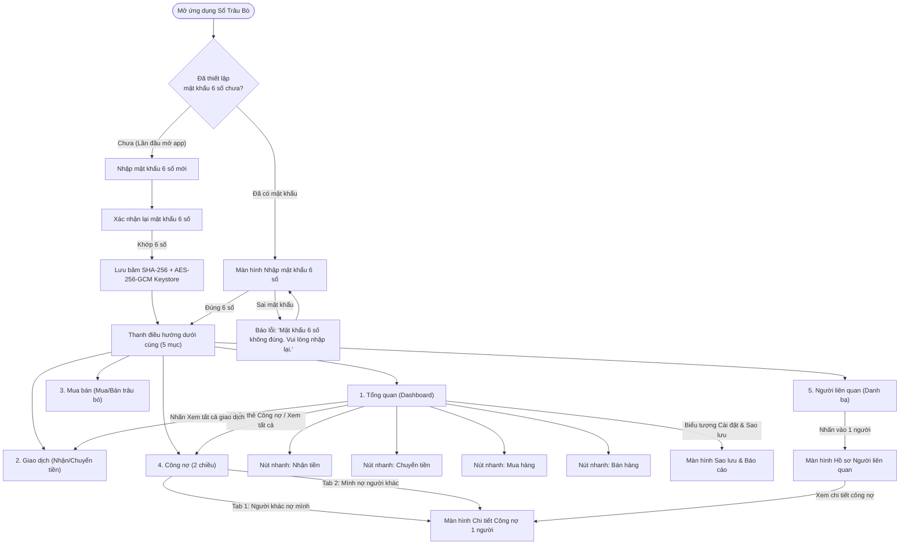
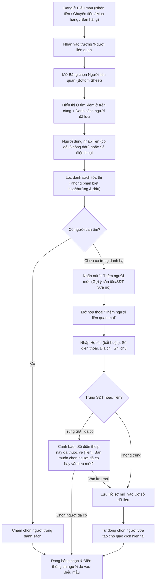
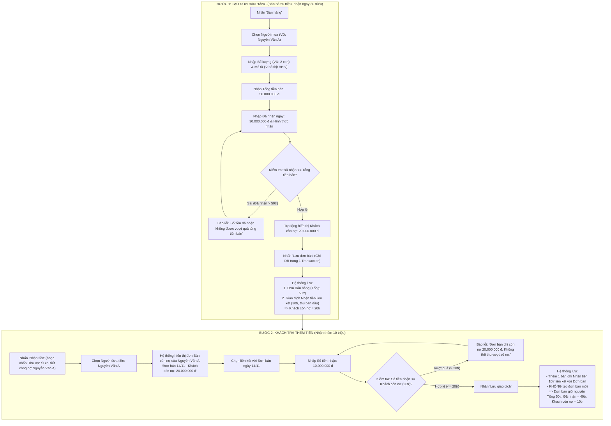
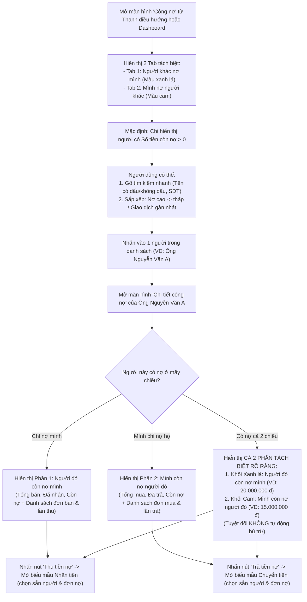
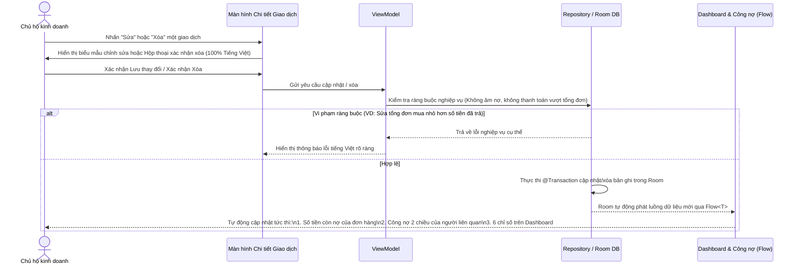
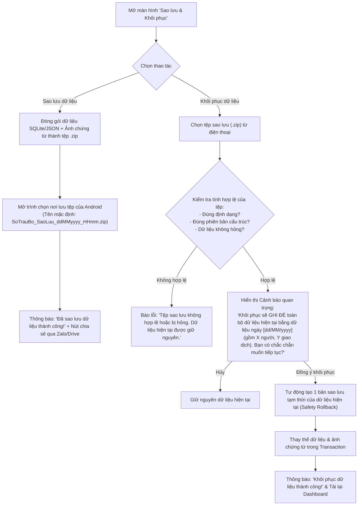

# 04. SƠ ĐỒ LUỒNG NGHIỆP VỤ VÀ LUỒNG NGƯỜI DÙNG (USER FLOWS)

Tài liệu này mô tả chi tiết các luồng tương tác của người dùng (User Flows) và luồng xử lý nghiệp vụ bằng sơ đồ trực quan (Mermaid Flowchart & Sequence Diagram). Toàn bộ nhãn và thông báo đều bằng tiếng Việt 100%.

---

## 1. Sơ đồ Tổng quan Điều hướng Ứng dụng & Khóa Mật khẩu 6 Số (App Navigation & PIN Flow)

---

## 2. Luồng Chọn Người liên quan hoặc Thêm Người mới ngay trong Biểu mẫu

Đây là luồng cốt lõi xuất hiện trong cả 4 biểu mẫu (**Nhận tiền**, **Chuyển tiền**, **Mua hàng**, **Bán hàng**), giúp người dùng không bao giờ phải nhập lại tên thủ công và đảm bảo mỗi người chỉ có duy nhất 1 hồ sơ.

---

## 3. Luồng Nghiệp vụ Mua hàng và Trả nợ thêm sau đó

Ví dụ minh họa: Mua bò `30.000.000 đ`, trả ngay `20.000.000 đ` (còn nợ `10.000.000 đ`), sau đó chuyển thêm `5.000.000 đ` (còn nợ `5.000.000 đ`).

---

## 4. Luồng Nghiệp vụ Bán hàng và Thu nợ thêm sau đó

Ví dụ minh họa: Bán bò `50.000.000 đ`, nhận ngay `30.000.000 đ` (khách còn nợ `20.000.000 đ`), sau đó khách trả thêm `10.000.000 đ` (khách còn nợ `10.000.000 đ`).

---

## 5. Luồng Tra cứu và Quản lý Công nợ Hai Chiều

---

## 6. Luồng Sửa / Xóa Giao dịch và Tự động Tính lại Số dư

---

## 7. Luồng Sao lưu và Khôi phục dữ liệu (Backup & Restore Flow)

