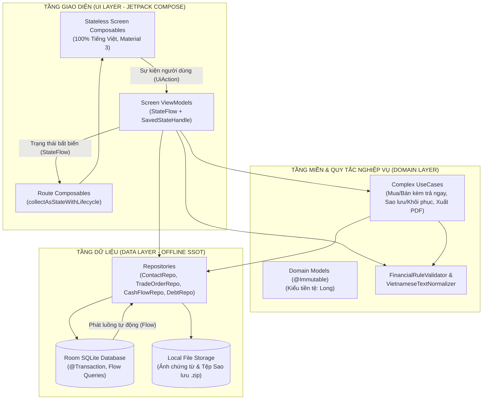

# 08. KIẾN TRÚC ỨNG DỤNG ANDROID (ANDROID ARCHITECTURE)

Tài liệu này định nghĩa kiến trúc kỹ thuật của ứng dụng theo đúng **Hướng dẫn Kiến trúc Ứng dụng Chính thức của Google (Official Android Architecture Guide)** và bộ quy chuẩn kỹ thuật Kotlin / Jetpack Compose hiện đại.

---

## 1. Tổng quan Kiến trúc (MVVM + Pragmatic Clean Architecture)

Ứng dụng được thiết kế theo mô hình **Unidirectional Data Flow (Luồng dữ liệu một chiều - UDF)** với 3 tầng rõ rệt:

1. **Tầng Giao diện (UI Layer — Jetpack Compose + ViewModel):**
   - **Composable Screens:** Tách thành `Route` (nhận `ViewModel`, thu thập trạng thái bằng `collectAsStateWithLifecycle()`) và `Stateless Screen` (chỉ nhận `UiState` bất biến và hàm callback `(Action) -> Unit` để dễ dàng viết `@Preview` và kiểm thử giao diện).
   - **ViewModel:** Giữ trạng thái màn hình thông qua một `StateFlow<UiState>` duy nhất được tạo bằng `stateIn(viewModelScope, SharingStarted.WhileSubscribed(5_000), initialValue)`. Không bao giờ giữ tham chiếu tới `Context`, `Activity` hay `View`.
2. **Tầng Nghiệp vụ / Miền (Domain Layer — Models & Validators/UseCases):**
   - Chứa các mô hình dữ liệu thuần Kotlin (`Contact`, `TradeOrderSummary`, `CashTransactionDetail`, `BidirectionalDebtProfile`, `DashboardSummary`), bộ chuẩn hóa tiếng Việt không dấu (`VietnameseTextNormalizer`), bộ định dạng tiền tệ/ngày tháng (`CurrencyFormatter`, `DateFormatter`), và các bộ kiểm tra quy tắc nghiệp vụ tài chính (`FinancialRuleValidator`).
   - Chỉ tạo UseCase cho các nghiệp vụ phức tạp phối hợp nhiều bảng (ví dụ: `SaveTradeOrderWithInitialPaymentUseCase`, `DeleteTradeOrderUseCase`, `ExportBackupUseCase`, `RestoreBackupUseCase`), tránh tạo các UseCase rỗng chỉ gọi 1-1 xuống Repository.
3. **Tầng Dữ liệu (Data Layer — Repository + Room Database + File Storage):**
   - **Single Source of Truth (SSOT):** Cơ sở dữ liệu Room (`CattleBusinessDatabase`) là nguồn dữ liệu chuẩn duy nhất.
   - Các Repository cung cấp dữ liệu dạng luồng phản ứng `Flow<T>` và các hàm thay đổi dữ liệu `suspend` an toàn trên luồng nền (`withContext(ioDispatcher)`).

---

## 2. Sơ đồ Kiến trúc Luồng Dữ liệu (Architecture Diagram)



---

## 3. Tổ chức Cấu trúc Gói (Package Structure)

Dự án được tổ chức theo cấu trúc rõ ràng, tách biệt từng tính năng và thành phần dùng chung:

```text
com.sotraubo.app/
├── di/                             # Cài đặt Dependency Injection (Hilt Modules: Database, Dispatchers)
├── core/
│   ├── common/
│   │   ├── dispatcher/             # @IoDispatcher, @DefaultDispatcher, @MainDispatcher
│   │   ├── format/                 # Định dạng tiền (30.000.000 đ), đọc số thành chữ, định dạng ngày dd/MM/yyyy
│   │   └── search/                 # VietnameseTextNormalizer (bỏ dấu tiếng Việt để tìm kiếm)
│   ├── designsystem/
│   │   ├── theme/                  # Color.kt (Xanh dương, Xanh lá, Đỏ, Cam), Type.kt, Theme.kt
│   │   └── component/              # CurrencyTextField, ContactPickerBottomSheet, DebtBadge, EmptyStateView
│   ├── model/                      # Mô hình miền thuần Kotlin (Contact, TradeOrder, CashTransaction, DebtSummary...)
│   ├── database/
│   │   ├── entity/                 # ContactEntity, TradeOrderEntity, CashTransactionEntity, AttachmentEntity
│   │   ├── dao/                    # ContactDao, TradeOrderDao, CashTransactionDao, DashboardDao, DebtDao
│   │   └── CattleBusinessDatabase.kt
│   └── data/
│       └── repository/             # ContactRepository, TradeOrderRepository, CashTransactionRepository, DebtRepository
├── feature/
│   ├── security/                   # Màn hình Khóa Mật khẩu 6 số (PinLockScreen, PinSecurityManager - SHA-256 + Keystore AES-GCM)
│   ├── dashboard/                  # Màn hình Tổng quan (DashboardScreen, DashboardViewModel, DashboardUiState)
│   ├── cashflow/                   # Màn hình Nhận tiền, Chuyển tiền & Lịch sử giao dịch
│   ├── trade/                      # Màn hình Mua hàng, Bán hàng & Chi tiết đơn mua/bán
│   ├── debt/                       # Màn hình Công nợ 2 Tab & Chi tiết công nợ 1 người (2 chiều)
│   ├── contact/                    # Màn hình Danh bạ Người liên quan & Chi tiết hồ sơ người liên quan
│   └── backupreport/               # Màn hình Báo cáo thống kê, Xuất PDF & Sao lưu / Khôi phục
└── navigation/
    └── AppNavHost.kt               # Điều hướng Type-safe Jetpack Navigation Compose (@Serializable routes)
```

---

## 4. Các Tiêu chuẩn Kỹ thuật Bắt buộc (Engineering Standards)

1. **Quản lý Đa luồng (Structured Concurrency & Main-Safety):**
   - Mọi thao tác đọc/ghi cơ sở dữ liệu, nén ảnh chứng từ, xuất PDF, đóng gói tệp sao lưu đều chạy trên `@IoDispatcher`.
   - Các phép biến đổi danh sách hoặc chuẩn hóa chuỗi lớn chạy trên `@DefaultDispatcher`.
   - Không bao giờ bắt `CancellationException` mà không ném lại (`rethrow`).
2. **Độ ổn định Recomposition trong Jetpack Compose:**
   - Tất cả các lớp `UiState` đều được đánh dấu `@Immutable` và sử dụng danh sách bất biến (`ImmutableList` từ `kotlinx.collections.immutable`).
   - Mọi `LazyColumn` hiển thị danh sách giao dịch, đơn hàng hoặc người nợ đều khai báo `key = { item.id }` và `contentType` rõ ràng để cuộn mượt ở tốc độ 60/120Hz.
3. **Bảo toàn Trạng thái qua Khi Hệ thống Thu hồi Bộ nhớ (Process Death Survival):**
   - Các biểu mẫu nhập liệu (**Nhận tiền**, **Chuyển tiền**, **Mua hàng**, **Bán hàng**) lưu trữ dữ liệu đang nhập trong `SavedStateHandle` (hoặc `rememberSaveable`).
   - Khi chủ hộ đang nhập dở đơn mua bò rồi mở ứng dụng Camera để chụp ảnh con bò (hoặc chuyển sang Zalo xem tin nhắn) khiến hệ điều hành Android thu hồi bộ nhớ nền, khi quay lại ứng dụng thì toàn bộ số tiền và thông tin vừa nhập **vẫn còn nguyên vẹn 100%**.
4. **Quản lý Ảnh đính kèm Tối ưu Dung lượng:**
   - Khi người dùng chụp ảnh hoặc chọn ảnh chứng từ/trâu bò, ứng dụng tự động nén ảnh thông minh về kích thước hợp lý (chiều dài tối đa `1600px`, chuẩn JPEG/WebP chất lượng `80%`, dung lượng ~150KB–300KB/ảnh) và lưu vào thư mục riêng `context.filesDir/attachments/` để không làm đầy bộ nhớ điện thoại sau nhiều năm sử dụng.
5. **Điều hướng An toàn Kiểu dữ liệu (Type-Safe Navigation Compose 2.8+):**
   - Sử dụng `@Serializable` cho toàn bộ các đích đến (Routes):
     - `DashboardRoute`
     - `TransactionListRoute(initialFilter: String? = null)`
     - `CashInFormRoute(preselectedContactId: Long? = null, preselectedSaleOrderId: Long? = null, editTransactionId: Long? = null)`
     - `CashOutFormRoute(preselectedContactId: Long? = null, preselectedPurchaseOrderId: Long? = null, editTransactionId: Long? = null)`
     - `PurchaseFormRoute(preselectedContactId: Long? = null, editOrderId: Long? = null)`
     - `SaleFormRoute(preselectedContactId: Long? = null, editOrderId: Long? = null)`
     - `DebtOverviewRoute(initialTab: Int = 0)`
     - `PersonDebtDetailRoute(contactId: Long)`
     - `ContactListRoute`
     - `ContactDetailRoute(contactId: Long)`
     - `BackupAndReportRoute`
