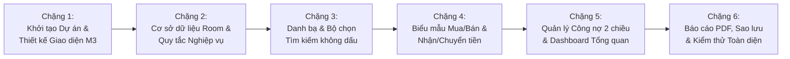

# 12. LỘ TRÌNH TRIỂN KHAI KỸ THUẬT (IMPLEMENTATION ROADMAP)

Tài liệu này hoạch định lộ trình xây dựng mã nguồn ứng dụng Android theo từng chặng (Sprint/Milestone) ngay sau khi thiết kế được phê duyệt. Mỗi chặng đều đi kèm kiểm thử tự động (Unit Test / UI Test) để đảm bảo chất lượng sản phẩm thực tế.

---

## Sơ đồ Lộ trình Triển khai (Implementation Flow)

---

## Chi tiết từng Chặng Triển khai

### Chặng 1: Khởi tạo Dự án, Kiến trúc nền tảng & Hệ thống Thiết kế (Foundation & Design System)
- Thiết lập Gradle Kotlin DSL (`build.gradle.kts`), Version Catalog (`gradle/libs.versions.toml`) với Kotlin 2.x, Jetpack Compose, Material 3, Room 2.6+ (KSP), Hilt, Navigation Compose 2.8+, Coroutines, kotlinx.serialization.
- Xây dựng hệ thống màu sắc ngữ nghĩa (`Xanh dương`, `Xanh lá`, `Đỏ`, `Cam`, `Xám`), bảng chữ cái tiếng Việt cỡ lớn dễ đọc.
- Xây dựng các thành phần dùng chung (`core/common` & `core/designsystem`):
  - Bộ chuẩn hóa tìm kiếm tiếng Việt không dấu (`VietnameseTextNormalizer`).
  - Bộ định dạng tiền tệ (`30.000.000 đ`) và đọc số tiền thành chữ tiếng Việt (`"Ba mươi triệu đồng"`).
  - Ô nhập tiền tệ thông minh (`CurrencyTextField`) kèm nút gợi ý nhanh.
  - Khung điều hướng 5 mục dưới cùng (`AppNavHost` + `BottomNavigationBar`).
- **Kiểm thử Chặng 1:** Unit test 100% cho `VietnameseTextNormalizer`, `CurrencyFormatter`, `DateFormatter`.

### Chặng 2: Tầng Dữ liệu Room SQLite & Kiểm tra Quy tắc Nghiệp vụ Tài chính (Database & Domain Rules)
- Cài đặt 4 bảng thực thể (`ContactEntity`, `TradeOrderEntity`, `CashTransactionEntity`, `AttachmentEntity`) kèm khóa ngoại và chỉ mục tối ưu.
- Cài đặt các `Dao` (`ContactDao`, `TradeOrderDao`, `CashTransactionDao`, `DebtDao`, `DashboardDao`) với các truy vấn SQL phản ứng (`Flow<T>`) và `@Transaction`.
- Cài đặt các Repository và `FinancialRuleValidator` (chặn thanh toán vượt số dư nợ, kiểm tra ràng buộc khi sửa/xóa giao dịch, tính toán công nợ 2 chiều độc lập).
- **Kiểm thử Chặng 2:** Kiểm thử toàn bộ các câu truy vấn DAO và các kịch bản nghiệp vụ **TC-01 đến TC-07, TC-11, TC-12, TC-14**.

### Chặng 3: Quản lý Người liên quan & Bộ chọn Người Thông minh (Contacts & Inline Picker)
- Xây dựng màn hình **Danh bạ Người liên quan** (danh sách, tìm kiếm không dấu, thêm/sửa hồ sơ).
- Xây dựng màn hình **Chi tiết Hồ sơ Người liên quan** (hiển thị 6 chỉ số tổng hợp của người đó + lịch sử Mua/Bán + lịch sử Nhận/Chuyển tiền).
- Xây dựng `ContactPickerBottomSheet` (Tìm kiếm tức thì theo tên có dấu/không dấu và SĐT + Hộp thoại **Thêm người mới ngay trong biểu mẫu** và tự động chọn).
- **Kiểm thử Chặng 3:** Kiểm thử **TC-08, TC-09, TC-10**.

### Chặng 4: Các Biểu mẫu Mua hàng, Bán hàng, Nhận tiền, Chuyển tiền & Đính kèm Ảnh (Core Transactions)
- Xây dựng biểu mẫu **Mua hàng** và **Bán hàng** (tự động tạo khoản thanh toán ban đầu liên kết nếu `Đã trả/Đã nhận > 0`, tự động tính số tiền còn nợ).
- Xây dựng biểu mẫu **Nhận tiền** và **Chuyển tiền** (hỗ trợ chọn liên kết đơn Mua/Bán đang nợ để trừ nợ hoặc ghi nhận độc lập; nút điền nhanh số tiền còn nợ).
- Xây dựng màn hình **Lịch sử Giao dịch** và **Danh sách Mua bán** kèm chức năng Xem chi tiết, Chỉnh sửa, Xóa (có tính lại công nợ tức thì) và Quản lý ảnh chứng từ đính kèm.
- **Kiểm thử Chặng 4:** Kiểm thử ViewModel & UI cho cả 4 biểu mẫu và luồng sửa/xóa.

### Chặng 5: Quản lý Công nợ Chi tiết 2 Chiều & Màn hình Tổng quan Dashboard (Debt & Dashboard)
- Xây dựng màn hình **Công nợ** với 2 Tab (*Người khác nợ mình* & *Mình nợ người khác*), thanh tìm kiếm nhanh không dấu, bộ sắp xếp (theo số tiền nợ / theo thời gian gần nhất).
- Xây dựng màn hình **Chi tiết Công nợ của một người** (hiển thị tách biệt 2 chiều công nợ, lịch sử thay đổi công nợ và nút Thu nợ / Trả nợ nhanh).
- Xây dựng màn hình **Tổng quan (Dashboard)** hoàn chỉnh:
  - 4 nút Thao tác nhanh.
  - 6 thẻ Tổng quan tài chính (nhấn để mở màn hình tương ứng).
  - 2 bảng Công nợ nổi bật.
  - Khu vực Thống kê kinh doanh (bộ lọc Hôm nay / Tuần / Tháng / Năm / Tùy chọn + Biểu đồ cột tiếng Việt).
  - Danh sách Giao dịch gần đây.
- **Kiểm thử Chặng 5:** Kiểm thử **TC-05, TC-13**.

### Chặng 6: Xuất Báo cáo PDF, Sao lưu/Khôi phục & Kiểm duyệt Chất lượng Cuối cùng (PDF, Backup & QA Gate)
- Xây dựng bộ xuất **Báo cáo PDF 100% Tiếng Việt** (Phiếu đối chiếu công nợ từng người & Báo cáo tổng hợp theo kỳ) và chia sẻ nhanh qua Zalo/In ấn.
- Xây dựng tính năng **Sao lưu & Khôi phục** tệp `.zip` kèm bước kiểm tra mã băm `SHA-256` và hộp thoại cảnh báo trước khi ghi đè (**TC-15**).
- Rà soát 100% câu chữ tiếng Việt, kiểm tra Android Lint, Detekt và chạy toàn bộ bộ kiểm thử từ **TC-01 đến TC-15**.
